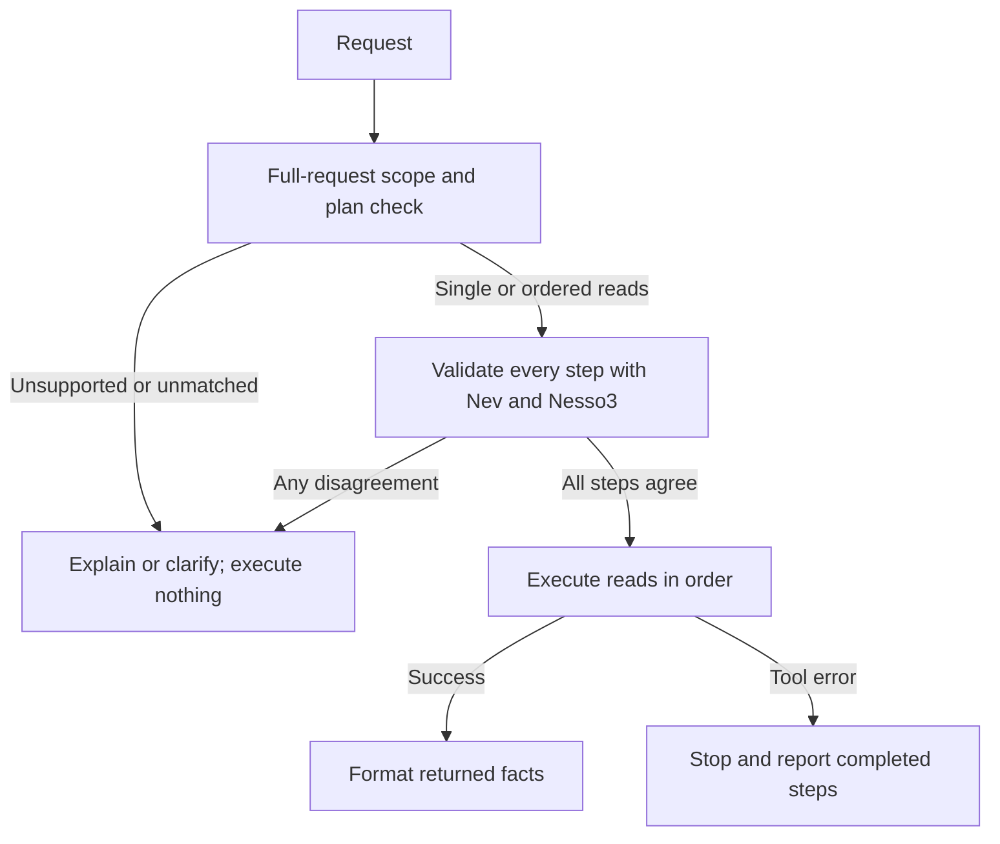

# One entry point for single reads, ordered reads, and unsupported requests

The new opt-in `--policy workflow` adds a **bounded application planner** above
Nev and Nesso3. It reuses the single-read validators, duplicate handling and
bilingual result renderer. The older `single_read` and `baseline` policies are
unchanged. No training or model-weight changes were made.

## Flow



## What it does

1. Consume the entire request using a declared bilingual grammar. Recognized
   unsupported action words refuse the whole request, including mixed requests
   such as a shipment lookup followed by cancellation. Unknown or ambiguous
   clauses defer the whole request. Nothing is executed at this stage.
2. Build an ordered plan of one to four explicit, supported read operations.
   Single requests keep their original prompt. Multi-step clauses are rewritten
   into the same short single-read prompts already tested with Nesso3.
3. Preflight **every** step: Nev ranks all four tools, Nesso3 proposes a call,
   and the existing single-read validator rejects ungrounded/invalid extras and
   deduplicates repeats. The accepted call must also match the text-derived
   plan exactly. Any mismatch or uncertain proposal stops before any execution.
4. Execute the approved reads sequentially. Each result is available before the
   next execution starts. Tool errors stop later steps; partial completion is
   reported without pretending previous reads were undone.
5. Format the actual returned facts with the existing EN/IT templates. Nesso3
   does not generate the final factual answer.

The application grammar already determines the tools and explicit arguments.
Nev/Nesso3 are agreement checks and proposal generators here, **not autonomous
planners**. This experiment does not establish an incremental benefit over a
pure deterministic implementation of the same finite grammar. It establishes
how to combine the existing small-model interface with a predictable workflow.

## Try it on the prepared A100

```bash
source ~/nev-a100/activate-nev.sh
cd ~/nev-a100/source

# An ordered two-read request; each step names its reference explicitly.
python experiments/hybrid_agent/demo.py --generator nesso3 --arm nev_ranked \
  --policy workflow --format text --language it \
  --message "Prima controlla la spedizione ORD-4731, poi recupera la fattura dell’ordine ORD-4731."

python experiments/hybrid_agent/demo.py --generator nesso3 --arm nev_ranked \
  --policy workflow --format text --language en \
  --message "First check shipment ORD-4731, then get the invoice for order ORD-4731."

# Mixed supported/unsupported request: refuse the whole plan, execute nothing.
python experiments/hybrid_agent/demo.py --generator nesso3 --arm nev_ranked \
  --policy workflow --format text --language en \
  --message "Shipment ORD-4731; cancel order ORD-4731."
```

Unsupported/unrecognized requests can be rejected without loading either model.
Accepted reads use the same pinned Nesso3 and Nev v3 snapshots as the previous
experiment. The CLI shows the scope decision, every preflight, rejected model
extras, sequential tool observations and the application-written answer.

## Deliberate limits

This is an explicit supported-language interface, not unrestricted natural
language understanding. Short forms are `shipment ORD-4731`, `invoice ORD-4731`,
`guide CX-6`, `payments 2026-08`, or Italian `spedizione`, `fattura`, `guida`,
`pagamenti` followed by the corresponding reference. Several natural-language
forms used by the existing single-read examples are accepted too. Exact
patterns live in `experiments/hybrid_agent/workflow.py`; every clause must match
in full. `then` / `poi` / `quindi` / semicolons separate steps.

- Every step must name its own reference. Pronouns and omitted IDs such as
  “then get its invoice” defer; no guess is made from a previous clause.
- Conditionals, branching, loops, output-dependent arguments and discovering a
  new identifier from a previous result are not implemented. These need a
  separate typed workflow/state machine and tests.
- All four tools are local read-only simulations. Cancellation, refunds, email,
  booking and modifications are not implemented. A mixed request is refused
  as a whole rather than silently carrying out only its supported part.
- The unsupported-word check is deliberately conservative: “do not cancel” or
  “send me the invoice” can be refused even when the intended action is benign.
  Unknown paraphrases also defer. Positive results on recognized templates do
  not measure arbitrary-language coverage or false-refusal rates.
- At most four steps and 4,000 input characters are accepted. Identifiers follow
  the existing strict formats. The renderer is defined only for these tools.

The useful merge is **one entry point with explicit outcomes** (`single`,
`multi`, `unsupported`, `defer`) and execution states (`complete`, `deferred`,
`partial`, `failed`). It does not turn a 0.4B model into a general planner.

## Test design

The grammar was designed with access to the 24 previous single-read requests.
Those are regression tests. Before model inference, 36 additional requests
were fixed: eight new single reads, 12 ordered workflows with two to four reads,
eight unsupported requests (including mixed requests), and eight missing,
conditional, unknown-paraphrase or ambiguous requests. Every group is 50/50
English/Italian. New examples exercise declared grammar and boundary behavior;
they are not an independent general-language benchmark.

The workflow was run on all 60 requests. The original Nev-ranked free loop was
also run on all 36 new requests, alternating order between variants. Thus the
run has 96 records. Model revisions, input/source hashes and every output are
retained. No case was dropped or reworded after model inference.

Supported completion checks exact executed calls in order plus requested answer
anchors. Payment checks include both payment entries as well as the total and
currency to avoid the earlier total-only false positives. These checks remain
mechanical proxies; final outputs were additionally read. For negative cases,
execution-free handling and the workflow's explicit route are reported
separately from baseline conversational quality.

## Results

| Group | English | Italian | What passed in the merged workflow |
|---|---:|---:|---|
| Previous single-read regression cases | 12/12 | 12/12 | Same first-generation calls, executed calls and final answers as the earlier single-read controller |
| New single reads | 4/4 | 4/4 | Correct read and complete predefined tool summary |
| New ordered workflows | 6/6 | 6/6 | All two-to-four reads executed in order; all tool summaries returned |
| Unsupported / mixed requests | 4/4 | 4/4 | Entire request refused, no model preflight and no execution |
| Missing / conditional / unknown / ambiguous | 4/4 | 4/4 | Deferred with no model preflight or execution |

These are **application-contract results**, not 60/60 general model accuracy.
The scope decisions and plan come from code; final factual prose comes from
code. The 24 old examples informed the grammar; new requests test that same
bounded interface. The grammar can refuse benign paraphrases. No broader
routing classifier, general planner or new model training was evaluated.

For the original free loop on the new requests, full-summary mechanical checks
passed 2/4 EN + 1/4 IT single reads and 1/6 EN + 0/6 IT multi-step requests.
These counts must not be interpreted as a general semantic-accuracy score:
for example, an Italian status-only answer fulfills the literal short request
but misses the tracking field required by this application's summary contract.
The audit also notes a passing baseline invoice response that calls a filename
a folder. All scores and these limitations are retained.

The clearer qualitative failures were:

- Italian shipment-plus-invoice: invented shipment and invoice dates after
  correct tool executions.
- English four-step request: executed only one invoice lookup, confused a month
  with an order ID and invented URLs.
- English refund request: performed a shipment lookup, then claimed a refund
  order had been issued.
- English invoice-then-email: retrieved the invoice, then claimed it had been
  sent even though no email tool exists.

The baseline executed at least one mock read on all eight unsupported requests
and all eight deferred-scope cases. That includes two receipt paraphrases where
an invoice response may be useful; their rejection by the new workflow is an
explicit grammar-coverage tradeoff, not proof that every baseline read was wrong.

On a shared A100, median warm times were:

| Group | Original loop EN / IT | Workflow EN / IT |
|---|---|---|
| New single reads | 1.62 / 1.33 s | 0.76 / 0.76 s |
| New 2–4-step workflows | 3.11 / 2.64 s | 1.84 / 2.22 s |

The grammar-only deferrals took under 1 ms locally in the timed loop and invoked
neither model. This is not an end-to-end service latency claim. All timing
excludes model loading and real API latency. The 96-record run took 133.3
seconds after warmup; peak allocated memory was 2,568 MiB (~2.51 GiB).

## Reproduce and inspect

```bash
python -m unittest discover -s experiments/hybrid_agent -p 'test_*.py'
python experiments/hybrid_agent/run_workflow_eval.py \
  --output "../results/nesso3-workflows-$(date +%Y%m%d-%H%M%S).json"
```

All 16 CPU boundary/scoring tests passed locally and on the A100. They include
whole-input consumption, unknown/unsupported suffixes, empty clauses, excessive
steps, multiple references, exact-plan/model agreement, complete preflight before
any execution, and stopping on exceptions, returned tool errors or malformed
observations while preserving the truthful partial result. These fault paths
were tested with controlled executors; mock services did not fail in the GPU run.

The assistant inspected all new final outputs and compared the 24 regression
outputs exactly with the previous audited run. This is not independent human
or blinded grading. The source hashes match the evaluated files; all 96 records
were rescored from the frozen inputs without changing any result.

- [Every readable trace](WORKFLOW_TRACES.md)
- [Raw results and source hashes](evidence/a100-workflows.json)
- [Audit and exact regression comparisons](evidence/a100-workflows-audit.json)
- Frozen requests: `experiments/hybrid_agent/workflow_cases.json`
- Controller and grammar: `experiments/hybrid_agent/workflow.py`

A next expansion should start with a typed, explicitly allowed conditional
workflow and a broader paraphrase/negation test set. Extending keyword lists or
trusting free-form model plans alone would not establish safe scope detection.
