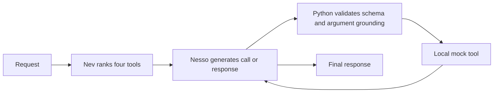

# Nesso3 + Nev: a bounded agent prototype

This prototype serves one user request through a bounded tool-and-response loop.
Nesso generates calls, arguments, clarification questions and final responses.
Nev v3 ranks the available tools. Python validates requests and executes **only
synthetic local read-only functions**; there are no real accounts or external
API actions. Both models remain resident on the A100 for the comparison.



## Current generator and simple examples

The default generator is now `giux78/nesso3-0.4B-agentic`, pinned to
`56f42f1c7eb82fbd48b0c4ee46aae7b8bed203b8`. Nev v3 and its revision are
unchanged. `--generator nesso2` retains the original pinned generator.

Read the [root README](../../README.md#try-nev-with-generative-nesso3-as-one-agent)
for the four successful curated examples and [every readable trace](../../docs/nesso3/SIMPLE_TRACES.md)
for all eight candidates in both modes. Eight examples were frozen before the
run: four domains, exactly four English and four Italian requests. Both modes
passed the same 2/4 EN + 2/4 IT strict checks; no ranking gain is established.
There was no prompt retry or controller repair. All unsuccessful calls remain
in `docs/nesso3/evidence/a100-simple-pilot.json`.

```bash
python experiments/hybrid_agent/run_pilot.py --generator nesso3 \
  --arms nesso_only nev_ranked --cases experiments/hybrid_agent/simple_cases.json \
  --output "../results/nesso3-simple-$(date +%Y%m%d-%H%M%S).json"
```

The A100 already has the pinned Nesso3 inference files cached. For a separate
authenticated installation, download them into the same HF cache used by the
runtime (alongside the Nev v3 snapshot):

```python
from huggingface_hub import snapshot_download
snapshot_download("giux78/nesso3-0.4B-agentic",
    revision="56f42f1c7eb82fbd48b0c4ee46aae7b8bed203b8",
    allow_patterns=["*.json", "*.safetensors", "*.jinja", "tokenizer.model"])
```

The model card and GitHub report were read before integration; retrieval
provenance is in `docs/nesso3/evidence/provenance.json`. The existing adapter
already matches its native contract: saved Llama-3 template, one BOS, compact
inline schemas, pure greedy calls and raw JSON observations. Generation and
controller logic were left unchanged. `demo.py --format text` renders actual
calls, observations, errors and answers; its JSON output records the generator
repository and revision too.

## Try the prototype

On the prepared A100:

```bash
source ~/nev-a100/activate-nev.sh
cd ~/nev-a100/source

python experiments/hybrid_agent/demo.py --generator nesso3 --arm nev_ranked --format text --language it \
  --message "Qual è lo stato della spedizione e il riferimento di tracciamento dell’ordine ORD-6101?"

python experiments/hybrid_agent/demo.py --generator nesso3 --arm nev_ranked --format text --language en \
  --message "Get the invoice for order ORD-6101 and tell me the filename."
```

The command prints model-selected calls, validation errors, mock observations,
final text and latency. `nesso_only`, `nev_ranked` and `nev_top2` are experimental
modes, not three trained models. A free-form interactive conversation interface
and real service integration are not implemented. The loop can take multiple
steps within one request; it is bounded at three tool rounds followed by one
last generation. It is not an unconstrained planner.

Model loading requires the existing runtime and Transformers environment, the
pinned snapshots cached locally and at least 8 GiB free GPU memory. The allocator
is capped at 8 GiB. Model loading is outside pilot timings.

## Historical Nesso2 frozen comparison

- Generator: `giux78/nesso2-0.4B-agentic-v2` at
  `dc74c2f5ec3330d3e22d697078646b547669da1a`, BF16.
- Decision model: `giux78/nev`, v3 at
  `c5c84121263b423f8846811a24790ab96e66cee3`, native FP32 cached inference.
- `nesso_only`: four tools in their fixed original order.
- `nev_ranked`: all four tools, ordered by Nev's probabilities.
- `nev_top2`: only the two highest-ranked tools. No automatic fallback is used
  in this arm, so the cost of excluding a needed tool remains measurable.

Nev ranks only once, before generation. It does not decide whether a tool is
needed; Nesso can respond or ask a question in every mode. No confidence
threshold or hard top-1 routing rule is applied. The scoring records whether
all required tools survived the top-2 selection.

The generator uses its saved native Llama-3 chat template, a compact `<tools>`
block inside the system message, exactly one initial BOS, greedy decoding and
192 new tokens per turn. It does not pass schemas through the template's ignored
`tools=` parameter. Repetition penalties are disabled in this frozen pilot.

`cases.json` contains 80 fixed requests in 40 parallel English/Italian pairs:
16 straightforward pairs, eight with distracting details, four sequential
shipment-then-invoice workflows, four missing-argument pairs, four requests
needing no tool, and four unsupported-action pairs. Some examples share templates;
80 requests do not represent 80 independent scenario designs. This is an
authored pilot, not a representative or official benchmark.

All three modes use the same request, schema definitions, argument checks, tool
results, token budget and loop limits. The mode order rotates between cases to
reduce timing-order bias on the shared GPU. Nev's measured routing cost is
attributed to each hybrid mode even though the ranking is computed once and
reused for the paired comparison. There is no claim of idle-GPU throughput.

## What is scored

**Exact calls** compares the entire emitted call sequence, including function
names and argument values, with the fixed expectation. Extra calls and retries
count against this strict metric. Non-tool cases require no calls. This is
stricter than checking only the first selected tool.

**Strict mechanical pass** additionally requires a final response, no validation
errors or token truncation, tool-result anchor strings in the answer, and calls
on distinct ordered turns for the sequential cases. Clarification and refusal
use explicit keyword/question-mark heuristics; no-tool answers use literal
answer anchors. These checks are reproducible proxies, not a semantic judge:
valid paraphrases can fail and a response containing the anchors can still be
wrong. Raw outputs are retained for review. Unsupported-action cases require
an explanation without attempting partial tool execution.

Identifiers and months must appear explicitly in the user request. The mock
functions are `get_order_status(order_id)`, `get_invoice(order_id)`,
`search_help_center(product)` and `list_transactions(month)`. This narrow
validator is not a general entity resolver, authorization system or production
business-rule engine. The model never sees gold labels or expected answer anchors.

## Reproduce

```bash
python -m unittest discover -s experiments/hybrid_agent -p test_agent.py
python experiments/hybrid_agent/run_pilot.py --generator nesso2 --schema-style compact \
  --output "../results/hybrid-$(date +%Y%m%d-%H%M%S).json"
```

Choose a fresh result path. Inputs, source hashes, pinned models, complete
assistant/tool traces, errors, summaries and GPU samples are stored in the
result file after each run. `--limit 2` is an engineering smoke check, not the
full comparison. The initial cache-loading smoke failure was fixed before
inference. The two successful smoke requests overlap the frozen pilot; they
were inspected for integration correctness, and no prompts were revised.

## Initial protocol result: validation fields exposed in schemas

The first 240-run comparison completed in 852.5 seconds. It exposed `pattern`
and `additionalProperties` fields to the generator as well as enforcing them
in Python. Strict mechanical passes were Nesso alone 1/40 EN + 3/40 IT;
Nev-ranked 2/40 + 2/40; Nev-top2 7/40 + 7/40. These are very low and not a
deployment recommendation. First-call exactness was much higher: 21/28 +
24/28, 20/28 + 20/28, and 22/28 + 19/28 respectively. Repeated calls after
valid observations were a major failure. Top2 dropped a required tool on four
Italian requests. Full traces are in `docs/nesso2/evidence/a100-hybrid-pilot.json`.

Manual review also exposed a heuristic false positive: `missing_invoice/it`
with Nesso alone asked for an order's filename/name, not clearly its identifier,
yet matched the question-mark/keyword check. A mechanical pass is not a
human-verified completed task. A follow-up checked the model card's minimal
schema format while keeping the same Python validation and frozen requests;
that is a protocol comparison on reused cases, not a new independent test.

## Compact-schema protocol follow-up

`--schema-style compact` removes `pattern` and `additionalProperties` from the
model-visible schemas, matching the minimal schema structure in the generator's
card. Python still enforces the same required arguments, patterns, grounding
and allowed-function checks. The older display remains reproducible with
`--schema-style validated`; its exact original source is retained in Git commit
`1cab00d`. No request or expected label was changed.

This protocol change was made after inspecting the initial run, so its repeat
on the same 80 requests is a development comparison, not a fresh test. All three
agent modes are rerun under the same compact protocol. The same two-request
engineering smoke check passed all three modes. Its outputs are retained too.

## Results and interpretation

A runnable prototype combines generative
`giux78/nesso2-0.4B-agentic-v2` with Nev v3. Nev ranks four available tools;
Nesso generates the function name and arguments, receives a simulated tool
result, and attempts a final response. Python enforces schema and argument
checks. All tools are local read-only simulations, with no real account actions.

The corrected compact-schema pilot used **80 authored requests, 40 EN / 40 IT**,
covering straightforward requests, distracting details, two-step workflows,
missing arguments, no-tool questions and unsupported actions. Each was run with
three modes on the shared A100. Both models remained resident; inference used
BF16 Nesso and native FP32 Nev. All model revisions, requests, labels and traces
are retained. No model weights were trained or changed.

| Mode | Strict checks EN /40 | Strict checks IT /40 | Total /80 | Median EN | Median IT |
|---|---:|---:|---:|---:|---:|
| Nesso alone | 9 | 14 | 23 | 1.97 s | 1.55 s |
| Nev-ranked → Nesso | 12 | 15 | 27 | 1.51 s | 1.59 s |
| Nev top-2 → Nesso | 6 | 11 | 17 | 1.52 s | 1.59 s |

“Strict checks” means exact emitted calls and arguments, no extra calls,
a final response containing required result anchors, sequential turns where
requested, and clarification/refusal heuristics. It is a **mechanical proxy**,
not human-verified task accuracy. Manual review found replies that passed the
checks but added unsupported or imprecise statements. This small, partly
templated pilot is not a representative benchmark. Timing includes the measured
Nev routing cost where used and local mock-tool overhead; real API latency is absent.

Ranking achieved six paired wins and two losses versus Nesso alone: **four net
additional passes (+5 percentage points)**. This is a small directional result,
not evidence of a reliable general improvement. Importantly, Nesso alone had
better **first-call exactness** on the 28 tool requests per language: 22/28 EN
and 26/28 IT, versus 20/28 and 24/28 with ranking. Ranking helped more runs finish
after the initial call; it did not improve first-call accuracy here.

Hard top-2 selection lost six passes overall and excluded a required tool on
all four Italian two-step requests. Every mode failed the strict two-step
checks in both languages. Common failures were repeating calls after a valid
observation, adding output fields to new arguments, and failing to finish with
a grounded answer. Keep all tools available in the current prototype and treat
Nev's ordering as experimental advice.

**A material integration finding:** the initial run exposed JSON Schema
`pattern` and `additionalProperties` fields to Nesso. It passed only 4/80 checks
alone, 4/80 with ranking and 14/80 with top-2. Removing those fields from the
model-visible schemas, following the model card's minimal format, produced the
table above. The same validation remained in Python. Thus the first apparent
shortlisting gain was not a sound recommendation. Both protocol runs are
retained. The compact follow-up reused the same cases after inspecting the first
run, so it is a development comparison; a fresh held-out evaluation is still needed.

The corrected 240-run comparison took **452 seconds**, with peak allocated GPU
memory **2,572 MiB (2.51 GiB)** for the resident models and inference. The first
protocol took 853 seconds. The next experiments should separate call generation
from answering after an observation, compare Nev ordering with randomized or
simple deterministic ordering, and evaluate on new bilingual requests before
claiming an agent-level gain.

Reproducible code and exact methodology are in `experiments/hybrid_agent/`;
complete corrected traces and analysis are in
`docs/nesso2/evidence/a100-hybrid-compact-pilot.json` and
`a100-hybrid-compact-analysis.json`. The original protocol and smoke records
remain alongside them. The source used for the first run is Git commit
`1cab00d`; the compact run used `9997ec5`. The prototype now defaults to compact
schemas; passing `--schema-style validated` reproduces the old schema display.
